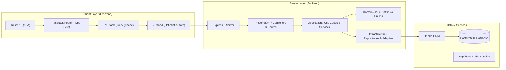

<div align="center">

# 🌌 Dev Studio

### *The Unified AI-Powered Developer Workstation & Engineering Command Center*

[](https://ms-dev-studio.vercel.app)

<br/>

[](https://github.com/darkpyramid-org/Dev-Studio-Full/actions/workflows/ci.yml)
[](https://github.com/darkpyramid-org/Dev-Studio-Full/actions/workflows/deploy.yml)
[](https://www.typescriptlang.org/)
[](https://react.dev/)
[](https://tailwindcss.com/)
[](https://expressjs.com/)
[](https://www.postgresql.org/)
[](https://orm.drizzle.team/)
[](./LICENSE)

<br/>

<p align="center">
  <a href="https://ms-dev-studio.vercel.app"><b>Explore Live App</b></a> •
  <a href="./docs/README.md"><b>Documentation</b></a> •
  <a href="./CONTRIBUTING.md"><b>Contribute</b></a> •
  <a href="./.github/ISSUE_TEMPLATE/bug_report.yml"><b>Report Bug</b></a> •
  <a href="./.github/ISSUE_TEMPLATE/feature_request.yml"><b>Request Feature</b></a> •
  <a href="./ACCESSIBILITY.md"><b>Accessibility</b></a>
</p>

</div>

---

## 💡 What is Dev Studio?

**Dev Studio** is a unified, local-first developer productivity suite designed to centralize and accelerate every stage of a modern software engineer's lifecycle. Rather than scattering your prompts, component snippets, career tracking, and interview preparation across dozens of disconnected tools, Dev Studio houses them under a cohesive, lightning-fast architecture.

```
                    ┌─────────────────────────────────────────┐
                    │               Dev Studio                │
                    ├────────────────────┬────────────────────┤
       Build & AI   │ • AI Agents Hub    │ • Prompt Studio    │
                    │ • Component Forge  │ • Code Snippets    │
                    ├────────────────────┼────────────────────┤
       Career & Growth│ • Interview Prep │ • ATS CV Scanner   │
                    │ • Job Tracker      │ • Skills Checklist │
                    ├────────────────────┼────────────────────┤
       Daily Flow   │ • Routine Planner  │ • Daily Activities │
                    │ • Email / Outreach │ • Integrations     │
                    └────────────────────┴────────────────────┘
```

---

## ⚡ Core Feature Matrix

| Domain | Capability | Description |
| :--- | :--- | :--- |
| 🤖 **AI & Prompts** | **Prompt Engineering Studio** | Rich prompt catalog with dynamic variable parser (`{{variable}}`), parameter controls (temperature, top-p), version history diffs, and instant clipboard exports. |
| 🤖 **AI & Prompts** | **Autonomous Agents Hub** | Custom agent personas with model selection, customizable system instructions, temperature limits, and external tool plugin configurations. |
| 🧩 **Engineering** | **Component Forge** | Interactive UI playground for React components with live previews, props inspector, Tailwind styling presets, and automatic dependency trees. |
| 📦 **Engineering** | **Scaffolding Templates** | Standard software starter stacks complete with technology descriptors, project structures, and dependency graphs. |
| 📎 **Engineering** | **Snippet Catalog** | Multilingual code repository with syntax highlighting, search tags, and instant insert tokens. |
| 🧠 **Interview Prep** | **Technical & Soft Skills** | 220+ curated questions across Frontend, Backend, DevOps, Databases, System Design, and Behavioral psychology with difficulty and progress tracking. |
| 💼 **Career Hub** | **Job & Opportunity Tracker** | Kanban pipeline for applications, freelance offers, and custom service portfolios across global platforms (LinkedIn, Upwork, RemoteOK, Mostaql). |
| 📄 **Career Hub** | **ATS CV Optimizer** | Resume analysis engine evaluating formatting, keyword density, section balance, and ATS pass rates. |
| 📅 **Productivity** | **Routine Planner & Wellness** | Integrated schedule organizer with recurring task presets, prayer times geolocation sync, habit streaks, and wellness metrics. |
| 📢 **Integrations** | **Social & Outreach Drafts** | Ready-to-send release copy, job pitch emails, and social media drafts with tokenized recipient replacement. |

---

## 🏛️ System Architecture

Dev Studio is structured as an enterprise-grade monorepo strictly adhering to **Clean Architecture**:



---

## 📂 Monorepo Organization

```bash
Dev-Studio-Full/
├── .github/                     # GitHub Actions CI/CD workflows, templates, and health files
│   ├── ISSUE_TEMPLATE/          # Modern interactive YAML issue forms (bugs, features, a11y)
│   ├── workflows/               # CI test matrix (ci.yml) & multi-target deploy (deploy.yml)
│   ├── CODE_OF_CONDUCT.md       # Community standards & Contributor Covenant
│   ├── SECURITY.md              # Security disclosure policy and supported versions
│   └── pull_request_template.md # PR guidelines and reviewer checklist
├── backend/                     # Express 5 server (Clean Architecture)
│   ├── src/
│   │   ├── domain/              # Entities, pure enums, and Drizzle table schemas
│   │   ├── application/         # Business logic and application services
│   │   ├── infrastructure/      # Database connection pool, seeds, and external clients
│   │   └── presentation/        # HTTP controllers, CORS policies, and route definitions
│   ├── tsconfig.json            # Development TypeScript configuration
│   └── tsconfig.build.json      # Production compiler configuration
├── frontend/                    # React 19 SPA (Vite + Tailwind CSS v4)
│   ├── src/
│   │   ├── components/          # Reusable UI primitives (shadcn/ui + Radix)
│   │   ├── features/            # Domain views (activities, career, interview, tools)
│   │   ├── lib/store/           # Zustand stores & optimistic CRUD factories
│   │   └── routes/              # TanStack Router file-based route tree
│   └── vite.config.ts           # Bundler plugins, test runner config, and proxy rules
├── docs/                        # Comprehensive developer documentation
│   ├── architecture/            # Component diagrams, data models, and route verification
│   ├── setup/                   # Environment variables, credentials, and setup guides
│   └── integrations/            # Outbound patterns, webhooks, and third-party APIs
├── docker-compose.yml           # Complete containerized local stack
├── CONTRIBUTING.md              # Git workflow, PR standards, and local validation checklist
├── ACCESSIBILITY.md             # Accessibility conformance statement (WCAG 2.1 AA)
├── GOVERNANCE.md                # Project governance, maintainer roles, and RFC workflow
├── SUPPORT.md                   # Support channels, FAQs, and contact resources
└── CHANGELOG.md                 # Semantic version release notes
```

---

## 🚀 Quick Start Guide

### 1. Prerequisites
- **Node.js**: `>= 20.0.0`
- **npm**: `>= 10.0.0`
- **PostgreSQL**: `>= 15` (or a free cloud database on [Supabase](https://supabase.com) / [Neon](https://neon.tech))

### 2. Clone the Repository
```bash
git clone https://github.com/darkpyramid-org/Dev-Studio-Full.git
cd Dev-Studio-Full
```

### 3. Install Monorepo Dependencies
```bash
npm install
```

### 4. Configure Environment Variables
Copy sample configurations into local environment files:
```bash
# Frontend configuration
cp frontend/.env.example frontend/.env

# Backend configuration
cp backend/.env.example backend/.env
```

> [!TIP]
> Refer to [docs/setup/ENVIRONMENT.md](./docs/setup/ENVIRONMENT.md) for full variable descriptions.

### 5. Initialize Database & Seed
```bash
# Push table schemas to PostgreSQL
npm run db:push --prefix backend

# Populate 220+ default questions, skills, and prompts
npm run db:seed --prefix backend
```

### 6. Launch Development Environment
```bash
npm run dev
```

- 🌐 **Frontend UI**: [http://localhost:5173](http://localhost:5173)
- 🔌 **Backend API**: [http://localhost:3000](http://localhost:3000)
- 🏥 **Health Check**: [http://localhost:3000/health](http://localhost:3000/health)

---

## 🐋 Docker Compose Setup

Run the entire isolated stack (Postgres database, API server, and Vite client) with a single command:

```bash
docker compose up -d
```

To view logs or stop the containers:
```bash
# Tail logs
docker compose logs -f

# Gracefully stop
docker compose down
```

---

## 🛠️ CLI Scripts Reference

| Command | Action | Scope |
| :--- | :--- | :--- |
| `npm run dev` | Runs frontend and backend concurrently with hot-reloading | Entire Monorepo |
| `npm run dev:frontend` | Starts Vite development server with HMR | `frontend` |
| `npm run dev:backend` | Starts Express server via Nodemon | `backend` |
| `npm run build:frontend` | Compiles and tree-shakes client SPA into `dist/` | `frontend` |
| `npm run build:backend` | Transpiles TypeScript into clean JavaScript in `dist/` | `backend` |
| `npm run lint:frontend` | Runs ESLint and checks React hook rules | `frontend` |
| `npm run test:frontend` | Executes Vitest unit and store test suites | `frontend` |
| `npm run test:backend` | Runs 220+ service, repository, and controller tests | `backend` |

---

## 🤝 Community & Governance

Dev Studio is built by developers for developers. We hold our codebase to rigorous accessibility, inclusivity, and architectural standards:

- 🤝 **[Contributing Guide](./CONTRIBUTING.md)** — Step-by-step PR workflow, git naming standards, and testing checklist.
- 🌟 **[Code of Conduct](./.github/CODE_OF_CONDUCT.md)** — Contributor Covenant v2.0 standards and community guidelines.
- 🛡️ **[Security Policy](./.github/SECURITY.md)** — Vulnerability reporting workflow and disclosure policy.
- ♿ **[Accessibility Statement](./ACCESSIBILITY.md)** — WCAG 2.1 AA conformance, keyboard navigation, and barrier reporting.
- 🆘 **[Support Resources](./SUPPORT.md)** — Documentation links, discussion channels, and direct contact.
- 🏛️ **[Project Governance](./GOVERNANCE.md)** — Maintainer responsibilities, RFC review, and decision principles.
- 📜 **[Changelog](./CHANGELOG.md)** — Detailed history of releases and enhancements.

---

## 📄 License

This project is licensed under the [MIT License](./LICENSE) © 2026 Dev Studio Contributors.
